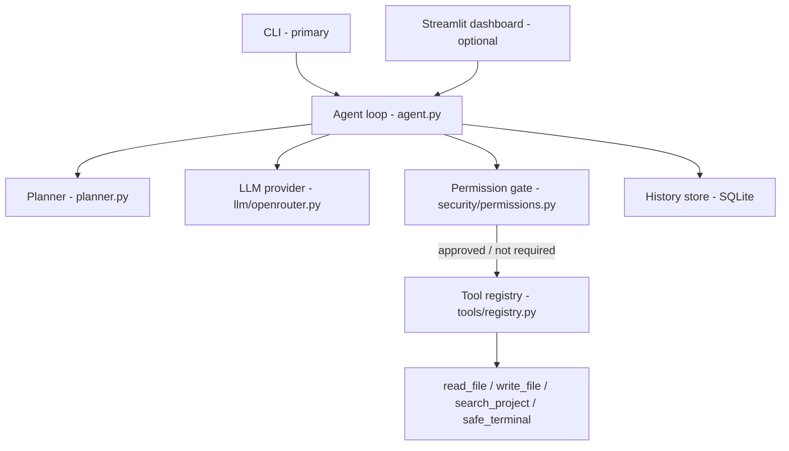

# DevPilot AI — an assessment-focused AI developer agent

A CLI AI agent that takes a natural-language development request, generates a plan with an LLM (OpenRouter), and executes it through four sandboxed tools — behind a per-action permission gate and with every step logged to SQLite.

> Repository: https://github.com/basharatfahad54-del/Devpilot-Ai

## Submission Checklist

| Assessment requirement | Where to find it |
|---|---|
| Analyzes the request | `src/devpilot/agent.py` (`Agent.run`) + [How It Works](#how-it-works) |
| Generates a plan | `src/devpilot/planner.py` (LLM-backed, deterministic fallback) + [Sample Execution](#sample-execution) |
| Uses an LLM via API | `src/devpilot/llm/openrouter.py` (OpenRouter, OpenAI-compatible function calling) |
| ≥2 executable tools | `src/devpilot/tools/` — `read_file`, `write_file`, `search_project`, `safe_terminal` |
| Shows tool calls + results | [Sample Execution](#sample-execution) (live transcript) + `rich` panels in `cli.py` |
| Permission / safety handling | `src/devpilot/security/permissions.py` + `tools/safe_terminal.py` + [Safety Model](#safety-model) |
| Error handling | Provider retry/backoff in `llm/openrouter.py`, per-tool `try/except`, graceful loop failure, `tests/integration/test_agent_loop.py` |
| Execution history / log | `src/devpilot/history/store.py` (SQLite) + `python cli.py history` / `inspect` |
| README (architecture, setup, usage, limitations) | This file |
| Screen recording | [Demo recording](#demo-recording) |
| What I personally implemented | [What I Personally Implemented](#what-i-personally-implemented) |
| AI tools & models used | [AI Tools & Models Used](#ai-tools--models-used) |
| Limitations & future work | [Limitations & Future Work](#limitations--future-work) |

## Problem Framing

Giving an LLM shell and filesystem access is the fastest way to build a useful coding agent and the fastest way to hand an attacker (or a hallucinating model) `rm -rf`. Most demos skip the uncomfortable part: what stops the model from deleting your source tree, reading your `.env`, or exfiltrating data over the network? DevPilot AI exists to demonstrate the *control plane* around an agent loop — a hard workspace boundary, a shell allowlist, a per-action approval gate for anything that writes or executes, secret redaction in logs, and a durable audit trail. The model is treated as untrusted input; the safety layer is deterministic code, not a prompt.

## Features → Assessment Mapping

- **Tool orchestration** — Four executable tools (`read_file`, `write_file`, `search_project`, `safe_terminal`) registered in `tools/registry.py` and exposed to the LLM as OpenAI-style function schemas. Satisfies *"≥2 executable tools"*.
- **LLM planning** — The planner requests a concise numbered plan from the model (`planner.py`), then the agent feeds each tool result back to the model to re-plan. Satisfies *"analyzes the request"* and *"generates a plan"*.
- **Safety controls** — Workspace-boundary enforcement, a shell allowlist/denylist, and a per-action approval prompt for writes and executions (`security/permissions.py`, `tools/safe_terminal.py`). Satisfies *"permission/safety handling for destructive actions"*.
- **Visible tool calls** — Every call is rendered live with `rich` (green = success, yellow = denied, red = blocked) and its output is shown inline. Satisfies *"clearly shows tool calls and their results"*.
- **Execution history** — Every task and tool call is persisted to SQLite with status, timing, redacted arguments, and the approval decision (`history/store.py`). Satisfies *"execution history/log"*.
- **Error handling** — HTTP 429/5xx retries with backoff, timeouts, per-tool exception isolation, malformed-argument handling, and a graceful `FAILED` state instead of a stack trace. Satisfies *"handles errors gracefully"*.
- **Permissive default, safe default** — Reads run without friction; anything that mutates state requires an explicit `y`. The gate can be disabled with `--yes` or `DEVPILOT_REQUIRE_APPROVAL=false`. Satisfies *"engineering judgment"*.

## Architecture



The agent loop is the spine of the system: **Analyze → Plan → Tool Call → Permission Gate → Execute → Log → Re-plan**. On each iteration the agent sends the conversation plus the tool schemas to the LLM. If the model returns tool calls, each one is parsed, checked against the permission gate, executed inside the workspace, and its result is appended back to the conversation before the next iteration. The loop terminates when the model returns a plain-text final answer (task `COMPLETED`) or when `DEVPILOT_MAX_STEPS` is reached (`FAILED`). Every tool call is written to SQLite between the gate and the next iteration, so the audit trail is complete even if the process crashes.

## Sample Execution

Captured from live runs with `OPENROUTER_MODEL=anthropic/claude-sonnet-4.6`. Colors are omitted below; in a terminal, success lines are green, the permission prompt is yellow, and blocked calls are red.

Run 1 — a read plus an approved write:

```text
$ python cli.py run "Read demo_input.txt, then create a file named greeting.txt with exactly the same content"

+-------------+
| DevPilot AI |
+-------------+
Task: Read demo_input.txt, then create a file named greeting.txt with exactly the same content
Task ID: 122d54ed

+----------------------------------- Plan ------------------------------------+
| 1. Open and read the contents of `demo_input.txt`.                          |
| 2. Open (or create) a new file named `greeting.txt` in write mode.          |
| 3. Write the exact contents read from `demo_input.txt` into `greeting.txt`. |
| 4. Close both files to ensure data is saved properly.                       |
+-----------------------------------------------------------------------------+

  ok  read_file({"path": "demo_input.txt"})          <-- green (success)
  +-----------------------------------------------------------------------------+
  |  Hello from DevPilot AI.                                                    |
  +-----------------------------------------------------------------------------+

+---------------------------- Permission required ----------------------------+   <-- yellow
| write_file  (permission: write_create, risk: medium)                        |
| {"path": "greeting.txt", "content": "Hello from DevPilot AI."}              |
+-----------------------------------------------------------------------------+
Allow this action? [y/N]: y

  ok  write_file({"path": "greeting.txt", "content": "Hello from DevPilot AI."})
  +-----------------------------------------------------------------------------+
  |  Wrote 23 chars                                                             |
  +-----------------------------------------------------------------------------+

+--------------------------------- Completed ---------------------------------+
| All done. greeting.txt now contains the same content as demo_input.txt.     |
+-----------------------------------------------------------------------------+
```

Run 2 — a command the model attempted, blocked by the allowlist (no approval can override it):

```text
$ python cli.py run "Use the safe_terminal tool to fetch https://example.com with curl" --yes

+----------------------------------- Plan ------------------------------------+
| 1. Verify curl is available on the system.                                  |
| 2. Run `curl -s https://example.com` via the safe_terminal tool.            |
+-----------------------------------------------------------------------------+

  blocked  safe_terminal({"command": "which curl"})     <-- red (blocked by policy)
    Blocked by safety policy: 'safe_terminal' rejected the arguments (invalid or not permitted)
  blocked  safe_terminal({"command": "curl -s https://example.com"})
    Blocked by safety policy: 'safe_terminal' rejected the arguments (invalid or not permitted)

+--------------------------------- Completed ---------------------------------+
| All curl commands were blocked by the safe_terminal policy. ...             |
+-----------------------------------------------------------------------------+
```

Run 3 — the audit trail the two runs left behind:

```text
$ python cli.py inspect 122d54ed-8d75-48c7-b78e-08cc13eeeb26

+---------------------------------- Request ----------------------------------+
| Read demo_input.txt, then create a file named greeting.txt ...              |
+-----------------------------------------------------------------------------+
Status: COMPLETED
                                  Tool Calls
+------------+--------------------------------+----------+--------------+----+
| Tool       | Args                           | Status   | Approval     | ms |
+------------+--------------------------------+----------+--------------+----+
| read_file  | {"path": "demo_input.txt"}     | SUCCESS  | not_required | 16 |
| write_file | {"path": "greeting.txt", ...}  | SUCCESS  | approved     |  0 |
+------------+--------------------------------+----------+--------------+----+
```

These runs are reproducible offline as deterministic tests in `tests/integration/test_agent_loop.py` (scripted fake LLM, real tools, real SQLite).

## Safety Model

- **Workspace boundary** — Every file operation resolves the target path and rejects anything outside `DEVPILOT_WORKSPACE` (`./workspace` by default); `../` traversal and absolute paths outside the root return `Path outside workspace` (`tools/read_file.py`, `tools/write_file.py`).
- **Shell allowlist / denylist** — `safe_terminal` is deny-by-default: it only runs allowlisted binaries (`python`, `pytest`, `git`, `ls`, `ruff`, …) plus Python scripts the agent authored. Destructive binaries (`rm`, `del`, `format`, `shutdown`, `diskpart`, `curl`, `wget`, `powershell`, …) are hard-denied, and shell metacharacters (`;`, `&&`, `|`, `>`, backticks) are rejected before execution (`tools/safe_terminal.py`). The deny check matches on the filename stem, so `powershell.exe` cannot slip past the `powershell` entry. This check runs regardless of approval.
- **Per-action approval gate** — Reads (`read_file`, `search_project`) run freely. Writes and executions require an explicit `y` at the terminal (or the action is denied and the model is told to try another approach). With no callback attached, the default is *deny* — the gate fails closed (`security/permissions.py`, `agent.py`).
- **Secret redaction** — Arguments are scrubbed for keys containing `api_key`, `token`, `secret`, `password`, or `authorization` before being written to history (`agent.py:redact_args`), and `search_project` skips `.env`, `id_rsa`, and `id_ed25519` (`tools/search_project.py`).

See [docs/SECURITY.md](docs/SECURITY.md) for the full list.

## How It Works

1. The user submits a request: `python cli.py run "..."`
2. The planner asks the LLM for a concise numbered plan (falls back to a deterministic skeleton if the model is unavailable).
3. The agent loops: send conversation + tool schemas → receive tool call(s) → execute → append the result → repeat, up to `DEVPILOT_MAX_STEPS` (default 10).
4. Before any write or execute action, the permission gate prompts `[y/N]`; reads pass through untouched.
5. Every tool call is logged to SQLite with status, duration, redacted arguments, and the approval decision.
6. When the model returns a final message, the task is marked `COMPLETED` and the summary is printed; failures are recorded as `FAILED` with the reason.

## Setup & Configuration

### Installation

```bash
python -m venv .venv
# Windows
.venv\Scripts\activate
# macOS/Linux
source .venv/bin/activate
pip install -r requirements.txt
```

### Configuration

Copy the example environment file and add your key:

```bash
cp .env.example .env
```

```env
OPENROUTER_API_KEY=your_key_here
OPENROUTER_MODEL=anthropic/claude-sonnet-4.6
DEVPILOT_REQUIRE_APPROVAL=true
```

Get a key at [openrouter.ai/keys](https://openrouter.ai/keys). Any OpenAI-compatible model slug on OpenRouter works.

> **API Key Security:** Your real `.env` is gitignored and never committed — only `.env.example` is tracked, with placeholder values. This follows the BYOK (bring-your-own-key) pattern: reviewers clone the repo, copy `.env.example` to `.env`, and add their own key. If a live key is ever shared for testing, use a disposable OpenRouter key with a spend limit and revoke it afterward.

## Usage

### Primary interface: CLI

```bash
python cli.py --help
python cli.py run "Create a simple Python calculator module with tests"
python cli.py run "..." --yes      # auto-approve write/execute actions (no prompts)
python cli.py history              # recent tasks
python cli.py inspect <task_id>    # full plan + tool-call log for a task
```

`python cli.py --help` output:

```text
 Usage: cli.py [OPTIONS] COMMAND [ARGS]...

 DevPilot AI - AI developer agent CLI

 Commands
   run      Run DevPilot AI on a task
   history  Show recent history
   inspect  Inspect a task
```

### Optional visual demo: Streamlit dashboard

A Streamlit dashboard is included for visual demonstration of the configuration, available tools, LLM responses, tool timeline, and history; the CLI is the primary interface and covers all assessment requirements.

```bash
streamlit run app.py
```

## Testing

**26 tests — 19 unit + 7 integration** — all runnable without API keys (the agent tests use a scripted fake LLM provider while exercising the real tools and a real SQLite database):

```bash
pytest -v
```

Unit tests cover tool argument validation and workspace boundaries, the approval policy, secret redaction, and allowlist bypass attempts (e.g. `powershell.exe`, `rm.exe`). Integration tests cover the full agent loop: tool execution, user approval, permission denial, allowlist blocking, and graceful LLM failure. CI (`.github/workflows/ci.yml`) runs `ruff check` and `pytest --cov` on every push.

## What I Personally Implemented

- Designed the agent loop and the permission-gate architecture: the LLM proposes actions, deterministic code decides whether they may run (`agent.py`, `security/permissions.py`).
- Wrote the shell allowlist/denylist and the workspace-boundary/path-traversal logic myself, including the decision to enforce the allowlist independently of user approval.
- Designed the SQLite history schema (tasks + tool_calls with status, timing, redacted args, approval decision) instead of a flat log file, so a task can be replayed with `inspect`.
- Used AI assistants to scaffold tool boilerplate, the OpenRouter client, and the Streamlit layout, then rewrote the permission flow and error handling after testing.
- Debugged real failures found during live runs: a stale default model slug (404 from OpenRouter), a `UnicodeEncodeError` when printing file contents with a BOM on a cp1252 Windows console, and a task left stuck in `EXECUTING` when a presentation-layer crash aborted the loop — fixed by isolating event rendering from agent state.

## AI Tools & Models Used

| Tool | Role |
|---|---|
| OpenCode (Claude Sonnet / GPT-4 class) | Scaffolding, boilerplate, first drafts of tools and UI |
| OpenRouter | Runtime LLM provider for the agent itself |
| ChatGPT | README drafting and diagram refinement |
| pytest / ruff | Written by me; used to verify generated code |

## Limitations & Future Work

**Limitations**

- Shell safety is an allowlist/denylist, which is brittle: it blocks harmless things (e.g. `python -c "..."`) and can't express complex commands.
- `safe_terminal` runs with the host user's privileges — there is no OS-level sandbox (no Docker/container isolation).
- Single-agent loop: no sub-agents, no parallel tool execution, no streaming.
- The approval prompt is CLI-only; the Streamlit dashboard visualizes but does not run the gated loop.
- History is a local SQLite file with no rotation or retention policy; there is no token/cost accounting.
- No deployment pipeline — a GitHub Actions workflow runs lint and tests, but there is no CD or monitoring.

**Future work**

- Docker-based tool sandbox with per-task containers.
- Sub-agent delegation for independent plan steps.
- Vector-search codebase index for large repos.
- A richer Git tool (status/diff/branch/commit) with its own approval rules.
- React + FastAPI UI with WebSocket streaming of the agent loop.
- Mocked-LLM end-to-end test in CI plus a cost/usage report per task.


## Documentation

- [Architecture](docs/ARCHITECTURE.md)
- [Security](docs/SECURITY.md)
- [Demo Script](docs/DEMO_SCRIPT.md)

## License & Contact

MIT — see [LICENSE](LICENSE). Questions: open an issue on the repository above.
